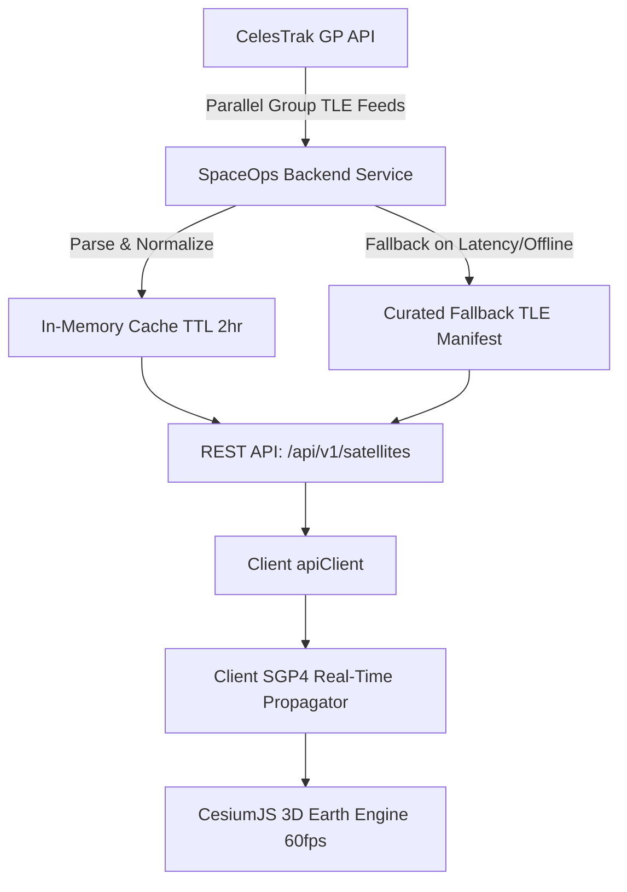

# Orbitron SpaceOps — Interactive 3D Earth & Satellite Tracking System

## 1. System Overview & Technology Stack
Orbitron SpaceOps integrates an aerospace-grade, data-driven 3D Earth and real-time satellite tracking system. Unlike decorative globes with mocked coordinates, Orbitron performs genuine mathematical orbital propagation using standard Two-Line Element (TLE) sets and general perturbation models.

### Primary Technologies
- **Geospatial 3D Engine**: CesiumJS (`cesium` + `vite-plugin-cesium`)
  - 3D WGS84 ellipsoidal Earth rendering
  - High-performance `PointPrimitiveCollection` for 60fps tracking
  - Glowing orbital trajectory polylines with depth testing
  - Realistic atmospheric scattering and solar illumination
  - Smooth camera manipulation, zooming, rotation, and target follow mode
- **Orbital Calculation Library**: `satellite.js` (SGP4/SDP4 Analytical Propagation)
  - Evaluates Earth gravitational harmonics ($J_2, J_3, J_4$), atmospheric drag (BSTAR), and lunar/solar perturbations
  - Coordinate transformations: Earth-Centered Inertial (ECI) $\to$ Earth-Centered Fixed (ECF) $\to$ WGS84 Geodetic (Latitude, Longitude, Altitude) $\to$ Cesium Cartesian3
- **Primary Orbital Element Provider**: [CelesTrak](https://celestrak.org) General Perturbations (GP) API
- **Frontend Framework**: React 19, React Router v7, Vite 8, TailwindCSS v4, Lucide Icons
- **Backend & Persistence**: Node.js, Express 5, Supabase Authentication & User Favorites

---

## 2. Satellite Data Pipeline & Caching Architecture



### Retrieval & Categorization
The backend queries CelesTrak for curated satellite groups:
1. `stations`: International Space Station (ISS), Tiangong (CSS), crew modules
2. `resource`: Earth Observation (Landsat 9, Sentinel-6, Terra, Aqua)
3. `weather`: Meteorological satellites (NOAA 20, GOES 18, MetOp)
4. `gps-ops`: Operational Navigation Constellations (GPS / NAVSTAR)
5. `science`: Astrophysical & Cosmic Observatories (Hubble, Chandra, Swift)
6. `visual`: Brightest Observable Satellites
7. `communications`: Starlink and global communication nodes

### Concurrency Protection & Caching
- **Single-Flight Lock**: Prevents multiple concurrent browser requests from triggering redundant upstream CelesTrak requests.
- **Cache TTL**: 2-hour sliding window.
- **Graceful Fallback**: If external network requests to CelesTrak experience latency, rate-limiting, or outages, the system automatically serves cached data or the verified `FALLBACK_SATELLITES` manifest with `dataQualityStatus: 'fallback'`.

---

## 3. Orbital Mathematics & Coordinate Transformations

### SGP4 Analytical Propagation
1. **TLE Ingestion**: TLE lines 1 and 2 are parsed into an SGP4 `satrec` structure via `satellite.twoline2satrec(tle1, tle2)`.
2. **Epoch Propagation**: For any time $t$, `satellite.propagate(satrec, t)` produces:
   - Position Vector $\vec{r}_{ECI} = [x, y, z]$ (km) in True Equator, Mean Equinox (TEME) frame
   - Velocity Vector $\vec{v}_{ECI} = [\dot{x}, \dot{y}, \dot{z}]$ (km/s)
3. **Sidereal Time Calculation**: Greenwich Mean Sidereal Time (GMST) $\theta_g$ is computed via `satellite.gstime(t)` to account for Earth's rotation.
4. **Geodetic Coordinate Conversion**: `satellite.eciToGeodetic(\vec{r}_{ECI}, \theta_g)` converts inertial coordinates into geographic latitude $\phi$, longitude $\lambda$, and ellipsoidal altitude $h$:
   $$\phi \in [-90^\circ, +90^\circ], \quad \lambda \in [-180^\circ, +180^\circ], \quad h \in \text{km}$$
5. **Cesium Cartesian3 Conversion**:
   $$\text{Cartesian3.fromDegrees}(\lambda, \phi, h \times 1000)$$

### Trajectory Sampling
To render the satellite's orbital trajectory without artificial discontinuities or date line tears:
- Orbital period $T = \frac{1440}{\text{mean\_motion}} \text{ minutes}$ is derived from the mean motion parameter.
- The path is sampled at 90-120 discrete intervals from $t - 0.15T$ (past trail) to $t + 0.85T$ (future path).
- Cesium renders the positions as a continuous 3D glowing polyline directly in world Cartesian3 space.

---

## 4. Distinction Between Times & Data Freshness
- **TLE Epoch Time**: The exact timestamp at which the orbital elements were fitted by US Space Command / NORAD tracking sensors.
- **Position Calculation Time**: The target time (e.g., current real-time UTC or simulated scrubber time) at which the SGP4 mathematical equations are evaluated.
- **Telemetry Observation**: Note that positions shown are *predicted analytical calculations*, not direct telemetry transmissions from the satellite bus.

---

## 5. API Endpoints Reference

| Endpoint | Method | Description |
|---|---|---|
| `/api/v1/satellites` | `GET` | Returns satellite catalog. Supports `?category=...`, `?search=...`, `?limit=...`, `?refresh=true` |
| `/api/v1/satellites/:noradId` | `GET` | Returns metadata, orbital characteristics, and current calculated position for NORAD ID |
| `/api/v1/satellites/:noradId/position` | `GET` | Returns SGP4 calculated position for satellite at `?time=ISO_TIMESTAMP` |
| `/api/v1/satellites/:noradId/orbit` | `GET` | Returns sampled orbital trajectory points across one complete orbital period |
| `/api/v1/satellites/categories` | `GET` | Returns available satellite categories with counts |
| `/api/v1/satellites/status` | `GET` | Returns CelesTrak provider health, cache timestamp, and data freshness |
| `/api/v1/satellites/refresh` | `POST` | Triggers a protected catalog refresh |

---

## 6. How to Run Locally & Execute Automated Tests

### Prerequisites
- Node.js 18+ (tested with Node 20+)
- npm 9+

### Start Development Server
```bash
# In repository root
npm run dev
```
- Frontend: `http://localhost:5173/satellites`
- Backend API: `http://localhost:5000/api/v1/satellites`

### Execute Automated Test Suite
```bash
# Run backend unit & integration tests
npm --prefix server test
```

### Validate Production Build
```bash
# Test Vite production bundle
npm --prefix client run build
```
